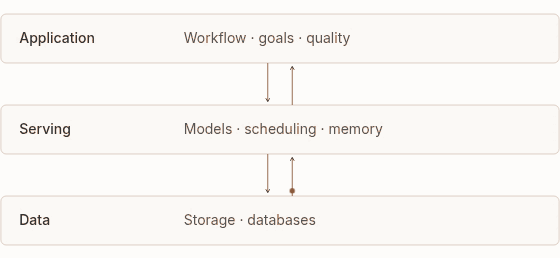
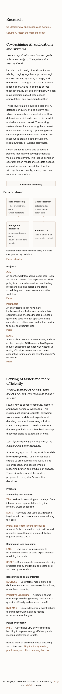

# Research and homepage previews — October 19, 2026

The Research page uses Rana's approved questions and explanations for two directions:

1. **Co-designing AI applications and systems** — Orla, Palimpzest, and MARS.
2. **Serving AI faster and more efficiently** — scheduling, routing, reasoning,
   communication, and power allocation. Model-informed systems is presented as a method.

Both pages use Inter body text, Lora headings, and the same warm palette.
The homepage now uses the new portrait, framed without changing the original image.
Google Scholar, LinkedIn, email, and GitHub icons appear on the homepage.
Profile links have been removed from Research. The blog is unchanged.

The Research page includes one small animated diagram. It has a pause control and
becomes static when the reader requests reduced motion. The GIF below demonstrates
the motion; the website uses HTML and CSS.

The first direction now explains how query planning, model selection, workflow
dependencies, data access, and context lifetime constrain one another. Its diagram
shows the decisions in data processing, model execution, storage, and runtime state.
The project descriptions explain the specific cross-layer decisions each system makes.

## Animated diagram

## Research — desktop

## Research — mobile

## Homepage — desktop

## Homepage — mobile

Validated with a Jekyll build, formatting and style checks, and Chromium at
1440px, 820px, 390px, and 320px widths. Checks cover the approved text, project links,
font loading, overflow, section navigation, mobile navigation, animation controls,
and reduced motion. A pre-existing template error (`addBackToTop is not defined`)
also occurs on the unchanged Blog page; the new page adds no browser errors.

These previews do not change the live website.
