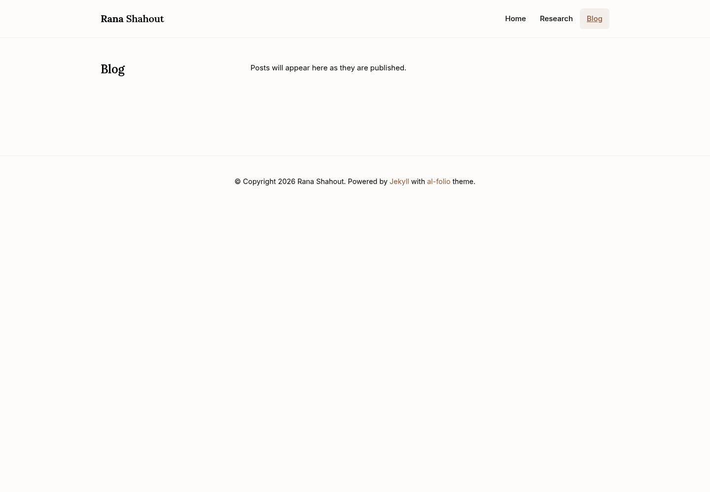
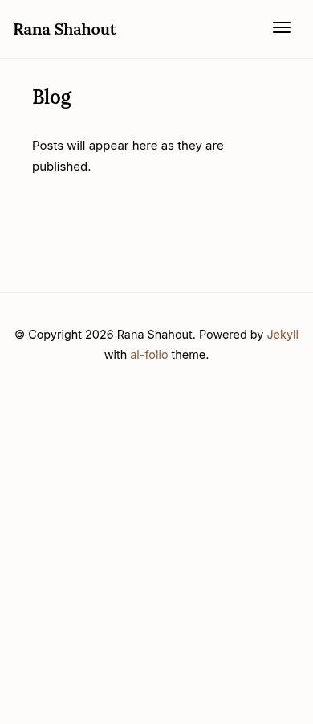

# Research and homepage previews — October 19, 2026

The Research page uses Rana's approved questions and explanations for two directions:

1. **Serving AI faster and more efficiently** — scheduling, routing, reasoning,
   communication, and power allocation. Model-informed systems is presented as a method.
2. **Co-designing AI applications and systems** — Orla, Palimpzest, and MARS.

Home, Research, and Blog share Inter body text, Lora headings, black text,
and the same warm light palette. Saved dark-mode preferences cannot change
the text or background.
The homepage now uses the new portrait, framed without changing the original image.
Google Scholar, LinkedIn, email, and GitHub icons appear on the homepage.
Profile links have been removed from Research. Blog now uses the same page
structure and navigation styles as the other tabs.

The serving direction appears first in both the page and its navigation.
The illustration and animation controls have been removed. The co-design section
explains the connections between query planning, model selection, workflow
dependencies, data access, and context lifetime.

## Research — desktop

## Research — mobile

## Homepage — desktop

## Homepage — mobile

## Blog — desktop

## Blog — mobile

Validated with a Jekyll build, formatting and style checks, and Chromium at
1440px, 820px, 390px, and 320px widths. Checks cover the approved text, project links,
font loading, overflow, section order, section navigation, mobile navigation,
and the removal of the illustration and its script. A pre-existing template error (`addBackToTop is not defined`)
also occurs on the unchanged Blog page; the new page adds no browser errors.

These previews do not change the live website.

The theme regression check (`npm run test:site-theme`) checks all three tabs with
saved light, dark, and system preferences under a dark OS preference, on desktop
and mobile, after a production build and CSS purging. It asserts black text, a
consistent light background, matching fonts, and no horizontal overflow. The
screenshots above were also captured with a saved dark preference.
